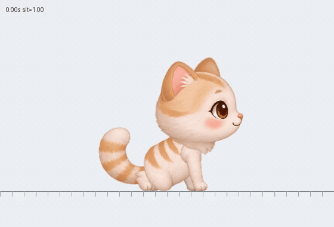

# 크림치즈냥 걷기와 서기 ↔ 앉기

아래 GIF는 **앉기 → 일어서기 → 걷기 → 정지 → 앉기**를 반복합니다.

[MP4 영상](media/cream-walk-stand-sit.mp4) · [GIF 파일 열기](https://raw.githubusercontent.com/cho-woo/yeopjari-cat/main/docs/media/cream-walk-stand-sit.gif)

실제 프로그램과 같은 C++ 파츠 렌더러와 Box2D로 만든 8초 미리보기입니다. 보기 쉽도록 두 배로 확대하고, 지면 눈금을 이동시켜 발의 접지 상태를 표시했습니다. Windows 바탕화면 녹화는 아닙니다. 앱에서는 고양이가 실제 화면 위를 이동합니다.

[구현 및 검증 범위](CREAM_LOCOMOTION.md)

Windows에서 동일한 실행파일로 렌더링한 [크기별·방향별 자세 비교](media/cream-walk-stand-sit-gdi.png)도 확인할 수 있습니다.
