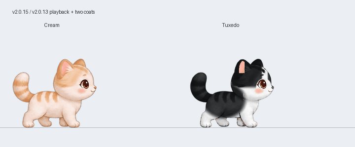
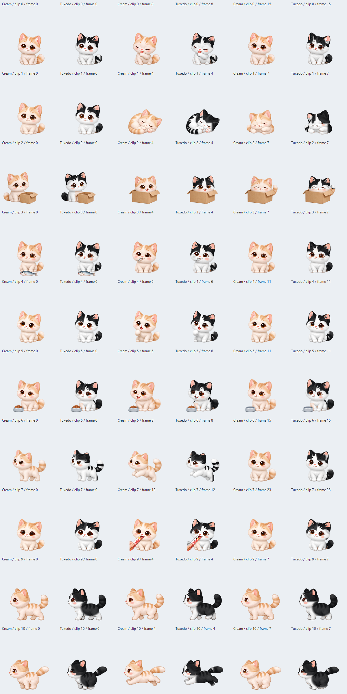

# v2.0.15 — 이전 재생 방식과 두 캐릭터

v2.0.14에서 추가한 부위별 걷기·앉기 렌더러와 출발 전 자세 대기를 제거하고, **v2.0.13의 걷기·행동 전환 구현**으로 복원했습니다. 업데이트 확인에서 받을 수 있도록 버전 번호는 2.0.15로 올립니다.

캐릭터는 **크림 치즈냥(저장 ID 0)**과 **턱시도냥(ID 8)**만 선택할 수 있습니다. 기존 생일·돌봄·성장 기록은 유지하며, 퇴출한 캐릭터의 저장값은 크림 치즈냥으로 옮깁니다. 두 번째 고양이의 기본 외형은 턱시도냥입니다.

두 캐릭터는 같은 9개 원화 시트, 10개 동작, 총 **120개 실제 원화**를 사용합니다. 걷기 8·뛰기 8·그루밍 16·수면 8·박스 8·생선 8·펀치 12·사료 12·점프 16·츄르 24장입니다. 턱시도냥은 원화의 알파·크기·기준점·재생 순서·이벤트·물리 설정을 그대로 공유하는 흑백 털 렌더링 변형입니다. 새로운 중간 원화를 추가한 것은 아닙니다.

털색은 원화 프레임을 읽을 때 미리 계산해 캐시합니다. 눈·코·귀 안쪽과 소품은 별도 보호 영역을 사용합니다. PNG 원본은 변경하지 않으며, 동작 프레임을 재생할 때 다시 디코딩하거나 색 변형을 계산하지 않습니다. 두 색상의 프레임 캐시는 총 111,336,864바이트이고 기존 192MiB 픽셀 예산 안에 포함합니다. 예전 혼합 캐릭터 이미지에서는 크림 치즈냥의 필요한 셀만 보존했습니다.

아래는 **실제 C++ 시퀀스 선택과 털 렌더링 코드로 만든 미리보기**이며, Windows 바탕화면을 녹화한 영상은 아닙니다. Windows GDI+ 실행 결과는 별도 이미지로 검증합니다.

[MP4 미리보기](media/two-cats.mp4) · [동작별 비교](media/two-cats-material.png)

자동 검사는 같은 원화 선택, 프레임별 알파 일치, 소품 보호, 저장값 이전, 기존 Box2D·돌봄 동작을 확인합니다. 화면 갱신 주기와 프로그램의 무음 동작은 v2.0.13과 같습니다. 유효한 64·128·256프레임 시트를 처리하는 기존 지원 구조도 유지합니다.

## 배포 및 검증 결과

2026-11-09에 [v2.0.15](https://github.com/cho-woo/yeopjari-cat/releases/tag/v2.0.15)를 공개했습니다. [Windows 검증 실행 42551063498](https://github.com/cho-woo/yeopjari-cat/actions/runs/42551063498)의 실제 실행파일을 그대로 배포했습니다.

- 소스 `5740458c3a09e1cee3a627aee930861e27e2c667`: 전체 자동 검사, Windows x64 빌드 및 패키지 검증 통과.
- Windows `--self-test`, `--render-self-test` 통과. 실제 120개 원화의 양방향 출력에서 두 색상의 알파가 완전히 일치하며, 각 프레임의 기준점과 크기는 동일합니다.
- 기존 64·128·256프레임 캐시·재생 검사와 Box2D·돌봄·커서·창 이동 회귀 검사 통과.
- GIF는 12초, MP4와 함께 공개 배포합니다. 최신 업데이트 피드와 EXE·ZIP·미리보기를 공개 URL에서 다시 내려받아 해시를 대조합니다.
- 실행파일: `build/verified-release-2.0.15/YeopjariCat-2.0.15.exe`, 24,514,560바이트. SHA-256: `7b5fd64493ab4241bb932d01c630558c0da242e30ef54b17a61b808147e6d266`.
- 이번 변경의 장시간 CPU·메모리 비교는 별도로 측정하지 않았습니다. 프레임 캐시 용량·실제 렌더링·저장 호환성 검사와 구분합니다.

