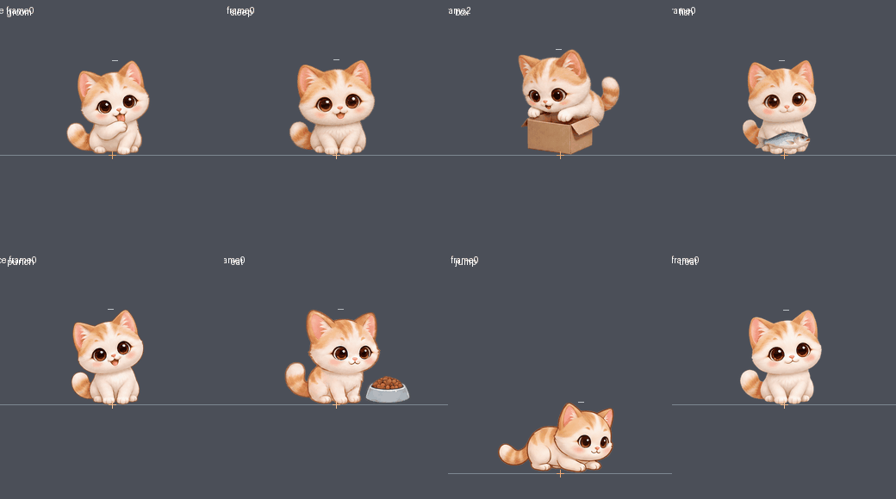

# v2.0.10 — 크림냥 돌봄 동작과 생선 주기

크림 치즈냥의 몸단장·수면·박스 숨기·생선 먹기·냥냥펀치·사료 먹기·점프·츄르 먹기에 전용 시트를 연결합니다. 기존 물리 이동 위에 각 동작의 자세를 재생하며, 첫째·둘째 크림냥이 같은 클립을 사용합니다. 생선 급식은 고양이 8종에 제공하며 강아지·토끼에는 비활성화합니다.

실제 시트 8개·104프레임과 사용 전후의 빈 박스를 포함한 v2.0.10을 배포했습니다. [배포 검사](https://github.com/cho-woo/yeopjari-cat/actions/runs/42168931229)에서 Windows x64 빌드·실제 실행·GDI+ 렌더링, 회귀 검사, ZIP·업데이트 피드·무음 검증을 통과했습니다. 공식 최신 피드와 공개 파일을 다시 내려받아 확인한 결과는 [공개 검증 기록](validation/v2.0.10-published.json)에 남겼습니다.

## 제공된 그림과 편집 범위

사용자가 제공한 RGB PNG 9장의 파일 정보와 SHA-256은 [원본 출처 기록](validation/v2.0.10-source-sprites.json)에 남깁니다. 이 중 돌봄 동작 8종을 투명 RGBA 에셋으로 처리합니다. [클립·격자·등록 규칙](CARE_SPRITES.md).

원본은 배경이 포함된 RGB 그림입니다. 이미지 편집 도구로 투명 배경을 만들고, 프레임마다 상자가 달라 보이는 부분과 손 흔들기에 가까웠던 펀치 자세를 다듬습니다. 펀치는 두 번의 타격이 기존 300/600ms 접점에 맞도록 제작합니다. 편집본은 원본보다 해상도가 낮고 일부 픽셀·털·얼굴·자세가 달라질 수 있습니다. 원본 픽셀을 그대로 추출했다는 주장은 하지 않습니다.

추가 걷기·뛰기 원본은 참고·출처 기록으로 유지합니다. 이미 실제 이동 거리와 발 접지를 연결한 v2.0.9 걷기·달리기를 새 그림 교체로 되돌리지 않습니다. 이번 변경에서 보행 제어기와 그 물리 경로는 유지합니다.

새 전용 그림은 크림냥에만 적용됩니다. 실버 태비와 다른 캐릭터는 기존 그림을 사용하며, 새 생선 급식에서도 해당 캐릭터의 기존 먹기 그림을 사용합니다. 캐릭터를 크림냥으로 강제 바꾸지 않습니다.

## 재생과 실제 물리 상태

몸단장과 냥냥펀치는 기존 랜덤 이벤트에서 재생합니다. 행동을 수동으로 고르는 메뉴를 추가하지 않습니다. 펀치의 화면 효과는 기존 접점을 유지하고, 프레임을 다시 그리거나 큰 시간 간격이 지나도 같은 타격을 중복 발생시키지 않습니다.

새 수면 시트는 깨어 있음·하품·졸림을 한 번 거친 뒤 웅크린 잠과 깊은 잠을 중심으로 재생합니다. 꿈꾸기·잠결 기지개·움찔은 드물게 등장하며 도입 하품을 수면 중 다시 반복하지 않습니다. 기상은 졸림→하품→깨어 있음 순서로 880ms 뒤 깨어 있는 자세를 유지합니다. 새 기본 수면의 선택 비율은 약 75%, 기존 다섯 다른 자세는 각각 약 5%이며 창 위 졸기도 유지합니다.

수면 자세는 잠들 때 한 번만 정합니다. 메뉴·숨기기·일시정지 때문에 동작 시작 시간이 보정되어도 선택한 자세가 바뀌지 않도록 수정합니다. 새 시트가 없는 캐릭터의 기존 수면 선택 비율은 유지합니다. 기존 12프레임 수면 형식도 계속 지원합니다.

점프는 Box2D의 실제 접지와 수직 속도로 자세를 고릅니다. 발이 붙은 출발 전 4번 그림은 비행에 사용하지 않고, 비행 5–11번과 접촉 후 착지 12–15번을 구분합니다. 창이 이동·확대·종료되어 착지에 실패하면 물리가 계속 낙하를 계산하고 그림도 하강 자세를 유지합니다. 점프 애니메이션이 별도로 높이나 착지 시각을 만들어내지 않습니다.

박스는 실제 장난감에 도착하고 멈춘 뒤 들어가기·숨기·빼꼼을 재생합니다. 프레임별 발·몸·소품 기준점을 수동으로 등록하고 공통 기준 높이를 사용해, 고개를 숙이거나 몸을 모아도 캐릭터 크기가 갑자기 바뀌지 않게 합니다. 시트의 박스를 기존 장난감 위치에 맞추고 중복 박스를 숨깁니다. 원본의 첫 두 컷은 고양이가 반대편으로 이동하므로 실제 접근·앞발 동작을 먼저 수행한 뒤 2–7번의 연속된 진입·숨기 자세를 재생합니다. 빈 박스도 같은 화풍의 별도 그림으로 연결하고, 입장 중에는 앞판만 앞에 그려 몸을 가립니다. 박스는 고양이의 진행 방향을 따라 뒤집히지 않습니다. 사료·츄르도 도입과 마무리를 한 번만 재생하고 먹는 구간을 반복합니다.

## 생선 급식과 호환성

첫째·둘째 고양이의 우클릭 메뉴에 생선 주기를 추가합니다. 공중에서 요청하면 종류를 보존한 채 실제 착지 뒤에 처리합니다. 지연 중 강아지·토끼로 바꾸면 생선을 급여하지 않고 요청을 해제합니다.

생선은 기존 밥과 같은 영양 모델을 사용합니다. 포만감 증가, 시간에 따른 체형, 배부름 거절, 밥·츄르와 공유하는 5분 대기 시간, 기존 식사 횟수와 식사 기억을 사용합니다. 거절·연타로 횟수나 친밀도가 늘지 않습니다. 승인된 생선 식사의 그림 표시는 다음 행동에서 해제되는 일시적 상태입니다.

생일·장기 성장·체형·성격·캐릭터·의상 키·기억·친밀도·개별 두 마리 기록의 저장 형식과 경로는 바꾸지 않습니다. 마이그레이션은 필요하지 않습니다. 기존 의상 키를 읽는 호환성, 무음, Windows 10/11 x64, Box2D 이동·창 지지·중력과 기존 우클릭 자동 업데이트 경로를 유지합니다.

## 검증 결과

배포 소스는 [919fb259e488](https://github.com/cho-woo/yeopjari-cat/commit/919fb259e488cf2c6e44be9bfcaa57a3b20d25eb)입니다. [병합 전 Windows 검사](https://github.com/cho-woo/yeopjari-cat/actions/runs/42168490680)와 [정식 배포 검사](https://github.com/cho-woo/yeopjari-cat/actions/runs/42168931229)가 통과했습니다.

- 시트 재생 279,112개 조건: 8/12프레임 수면, 격자·프레임 수, 일시정지·기상, 수면 선택 확률, 펀치 접점과 물리 상태별 점프.
- 생선 급식 1,736개 조건: 기존 밥과 같은 결과, 공통 대기 시간·거절, 장기 체형, 횟수·기억·저장 호환성과 허용 캐릭터.
- 두 번째 동물 3,316개 조건: 기존 동작 회귀, 급식·거절·기억·일시정지·재시작과 긴 메뉴 대기 후 새 식사를 0프레임부터 시작하는 동작.
- 실제 Windows EXE의 메뉴·지연 급식·커서·창 지지와 기존 GDI+ 동작 검사.
- 실제 RGBA 104컷의 독립 원본 영역·기준점·알파 합성, 96개 체형/방향/크기 조합과 새 그림 선택·기존 그림 대체 경로.
- Windows x64 패키지, ZIP 내부 구성·해시, 업데이트 피드와 무음 검증. 공개 후 공식 최신 피드와 공개 파일도 재다운로드해 검증했습니다.

공개 검증 시각은 2026-11-06 05:36:59 UTC입니다. [공개 파일 검증 기록](validation/v2.0.10-published.json).

Windows 자동 실행 검사는 Windows Server 2022의 GitHub Actions에서 수행했습니다. Windows 10/11 사용자 PC의 장시간 수동 관찰은 포함하지 않습니다.

## 새 동작 미리보기

실제 C++ 클립 선택과 등록 메타데이터를 실행하고 Pillow로 배치한 개발용 미리보기입니다. Windows 화면 녹화는 아닙니다. 점프 궤적은 미리보기용이며 앱의 높이·이동·착지는 Box2D가 결정합니다. [크기 비교](previews/v2.0.10-care-size.png) · [104컷 등록 검사](previews/v2.0.10-care-review.json).
