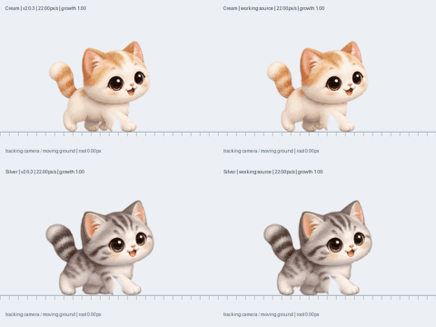
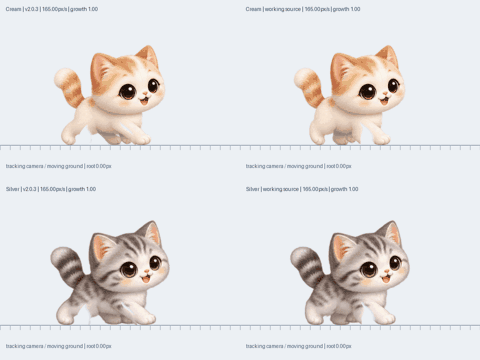

# v2.0.4 — 기존 2D 걷기·달리기 수정

기존 2D 캐릭터와 Box2D 이동을 유지하고, 보행만 수정합니다. 3D 실험은 정식 버전에 포함하지 않습니다. Windows x64 빌드·실행·그리기, ZIP, 업데이트 피드 검사를 모두 통과한 파일을 공개했습니다.

## 수정 원인과 범위

기존 달리기는 32px 보폭으로 성묘에서 초당 4.1~6.25회, 가장 어린 고양이에서는 최대 약 8.8회 반복됐습니다. 기존 미리보기의 92px/s보다 실제 130~200px/s 이동이 빨라 문제가 덜 드러났습니다. 실제 이동 속도를 사용하는 보폭 계산으로 바꾸고, 165 body-px/s 이상에서 보폭을 52px까지 늘립니다. 물리 이동 속도나 점프·충돌 계산을 바꾸지 않습니다.

걷기에서 달리기로 바뀔 때 이전 계산은 한 발을 약 17.6px 순간 이동시킬 수 있었습니다. 이제 발마다 바닥을 디딘 위치와 들어 올리는 구간을 기억합니다. 보폭·발 순서가 바뀌어도 디딘 발은 실제 이동량만큼 몸에 대해 뒤로 움직입니다. 다리가 닿는 범위 끝에 이르면 그 위치에서 발을 들어 다음 착지점으로 부드럽게 옮깁니다. 240Hz 내부 적분으로 화면 갱신률 차이를 줄입니다.

크림 치즈냥과 실버 태비냥 원본의 안쪽 앞발·뒷발은 별도 발인데 한 레이어에 묶여 있었습니다. 두 발을 분리하고 배 아래에 가려진 다리 뿌리가 털을 끌어내리지 않도록 경계를 수정합니다. 얼굴과 위쪽 몸통의 원본 픽셀을 보존합니다. 다른 캐릭터는 자체 그림의 기존 분할을 유지하며, 실제 속도와 접지 계산을 함께 사용합니다.

두 동물이 같은 보행 계산을 사용합니다. 저장 경로·형식과 생일·성장·체형·성격·기억·친밀도·캐릭터·과거 의상 키는 그대로입니다. 마이그레이션은 필요하지 않습니다. 자동 업데이트와 무음을 유지합니다.

## 움직임 비교

왼쪽은 v2.0.3, 오른쪽은 수정본입니다. 위는 크림 치즈냥, 아래는 실버 태비냥입니다. 같은 실제 이동 속도에서 카메라가 몸을 따라가므로 지면 눈금이 뒤로 움직입니다. 원본 그림은 동일합니다.

걷기 22px/s:

달리기 165px/s:

## 검증 방법

- `bash tools/check.sh`: 휴대 가능한 모델·저장 호환성·실제 Box2D 회귀 검사, Windows x64 교차 빌드, 무음 EXE·ZIP·피드 검사.
- `python3 tools/render_2d_gait_motion.py`: v2.0.3과 현재 C++ 보행을 실제 성묘·새끼 속도로 비교. 카메라를 고정한 이동과 몸을 따라가는 화면을 따로 출력합니다. 원본 PNG는 수정하지 않습니다.
- `python3 tools/render_gait_review.py`: 캐릭터·체형별 실제 그림의 얼굴 보존, 잘림·접지를 확인합니다.
- GitHub 검증·배포 워크플로: 같은 패키지를 Windows에서 실행해 `--self-test`, `--render-self-test`를 통과시킵니다. 배포 워크플로는 이 결과가 모두 성공한 뒤에만 GitHub Release와 공식 피드를 공개합니다.

미리보기는 C++ 결과를 Pillow로 배치한 영상이고, Windows GDI+ 실행 검사는 별도로 수행합니다. 기존 2D 원본에 기반한 움직임이며 좌우 방향 전환과 다른 행동의 원본 자세 교체는 이번 변경 범위 밖입니다.

## 로컬 검증 결과

전체 `tools/check.sh`가 통과해 Windows x64 EXE와 ZIP·피드를 만들었습니다. 실제 그림 2,250개 정적 자세와 6,120개 연속 이동 표본을 검사했습니다. 연속 검사는 정지·재출발·살금살금·달리기와 최대 새끼 속도(크림 약 280.49, 토끼 약 308.54 body-px/s)를 포함합니다. 얼굴과 위쪽 몸통 픽셀은 원본과 같고, 발 잘림이나 렌더 거부는 없었습니다. 가장 낮은 발과 지지면 차이는 약 -0.642~+0.678px였습니다. [그림 검증 기록](validation/v2.0.4-gait.json).

대표 성묘 달리기 165px/s에서는 반복 주기가 약 5.16→3.17회/초, 새끼 189.75px/s·성장 배율 .82에서는 7.23→4.45회/초로 줄었습니다. 가장 빠른 새끼는 이보다 빠르게 움직입니다. 정지 화면만 느리게 돌린 수치가 아니라 실제 이동 거리에 맞춘 주기입니다.

## 배포 상태

[v2.0.4 정식 릴리스](https://github.com/cho-woo/yeopjari-cat/releases/tag/v2.0.4)를 공개했습니다. [배포 검사](https://github.com/cho-woo/yeopjari-cat/actions/runs/41977961440)의 빌드·Windows 실행·그리기·공개 작업이 모두 성공했습니다. 태그와 검사 소스는 [30737e9f83b26c5d22c335f4910d5c263c317b45](https://github.com/cho-woo/yeopjari-cat/commit/30737e9f83b26c5d22c335f4910d5c263c317b45)로 일치합니다.

공개 직후 `2026-11-05T06:08:14+00:00`에 다섯 파일을 다시 내려받아 크기·SHA-256, ZIP의 여섯 항목·CRC, 단독 EXE와 ZIP 안 EXE의 동일성, 버전·노트·공식 피드를 확인했습니다. 공식 `latest.txt`는 2.0.4를 가리켰습니다. 내장 원본 PNG 11개가 소스와 일치하고 음원 리소스와 재생 함수 import는 0개입니다. [공개 파일 검증 기록](validation/v2.0.4-published.json).

| 파일 | SHA-256 |
| --- | --- |
| `YeopjariCat-2.0.4.exe` | `48f773717d56bbf6d2045a6a0a7663c93ca8a117233798a2caab1143bfbb92f3` |
| `YeopjariCat-Windows-2.0.4.zip` | `d6378ae1450403c36650caac495a4d5473b9d60ba86d21cf4cc4553281015451` |

자동 검사와 대표 시점의 시각 검토를 통과했지만, 모든 PC·DPI·창 조합의 육안 검수를 의미하지는 않습니다.
