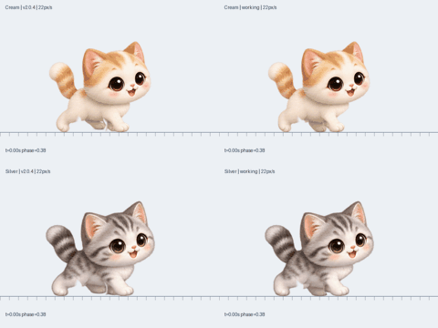

# v2.0.5 — 걷는 자세 수정

이번 수정은 기존 2D 고양이가 걷는 자세에 집중합니다. 얼굴·털 원본과 물리 이동 속도는 그대로입니다.

## 왜 걷는 폼이 어색했는가

이전 버전은 발이 바닥에서 미끄러지는지를 검사했지만, 좌우 발의 순서가 고양이의 네 발 보행과 맞지 않았습니다. 앞발 두 개와 뒷발 두 개가 각각 ¼주기 차이로 움직였습니다. 반 주기 차이로 번갈아 움직이도록 고치고, 같은 쪽 뒷발 다음에 앞발을 디디는 순서를 맞춥니다.

또한 원본 발의 아래쪽 4%만 고정해 둥근 발등은 여전히 늘어나고 있었습니다. 크림·실버의 실제 발목 주름까지 발 전체를 고정하고, 다리는 그 위에서 굽힙니다. 앞발과 뒷발의 중심도 어깨·엉덩이 아래로 옮겨 원본의 이미 뻗은 자세에서 다시 과하게 뻗는 현상을 줄입니다. 발 중심은 접지 상태에 포함해, 이 변화가 발 미끄러짐을 다시 만들지 않게 합니다.

안쪽 뒷발을 자르던 넓은 수직 경계는 실제 발가락 사이의 좁은 곡선으로 바꿉니다. 걷는 동안 밝은 절단선이 보이거나 발이 납작한 덩어리로 보이던 부분을 수정합니다.

## 걷기 비교

왼쪽 v2.0.4, 오른쪽 수정본입니다. 위는 크림, 아래는 실버이며 실제 이동 속도는 모두 22px/s입니다. 같은 C++ 보행 계산과 원본 그림을 사용합니다. 카메라가 고양이를 따라가는 화면에서는 지면 눈금이 움직입니다.

아래는 같은 동작을 4배 느리게 보여줍니다.

## 검증 범위

- 좌우 앞발·뒷발의 반 주기 교대와 네 발 착지 순서.
- 발등의 무늬가 발가락과 함께 그대로 이동하는지 확인하는 회귀 검사. 이전 발바닥만 고정하는 방식은 이 검사에서 실패합니다.
- 발 중심이 바뀌어도 접지 중 바닥 위치 유지, 정지·재출발·속도 전환, 체형·성장 크기 회귀 검사.
- 원본 그림에서 발 분리 경계와 발 형태를 한 주기 전체·실제 속도·4배 느린 화면으로 검토.
- Windows x64 빌드·실행·GDI+ 그리기, 기존 저장·Box2D·커서·창 이동 검사, ZIP·업데이트 피드 검사.

`python3 tools/render_walk_review.py`로 걷기만 다시 비교할 수 있습니다. 이 미리보기는 실제 C++ 계산에 Pillow 합성을 사용하며 Windows GDI+ 실행 검증은 별도입니다. 자동 검사 통과만으로 모든 모션이 자연스럽다고 판단하지 않습니다.

저장 형식·경로·원본 PNG는 바꾸지 않았습니다. 생일·성장·체형·성격·기억·친밀도·캐릭터 기록과 자동 업데이트를 유지합니다. 마이그레이션은 필요하지 않습니다.

## 로컬 검증 결과

`tools/check.sh` 전체 검사, Windows x64 교차 빌드와 ZIP·피드 검증을 통과했습니다. 원본 그림 10종·세 체형의 정적 자세 2,250개와 정지·재출발·속도 전환을 포함한 연속 표본 6,120개를 검사했습니다. 잘림·잘못된 알파·렌더 실패는 없고, 얼굴·위쪽 몸통 픽셀은 원본과 같습니다. 이 회귀 검사는 다른 동작을 새로 만드는 작업이 아니라 걷기 수정의 부작용을 확인하는 검사입니다. [그림 검사 기록](validation/v2.0.5-walk.json).

## 배포 상태

검증 중입니다. 모든 배포 검사가 통과한 뒤 공개 결과를 기록합니다.
