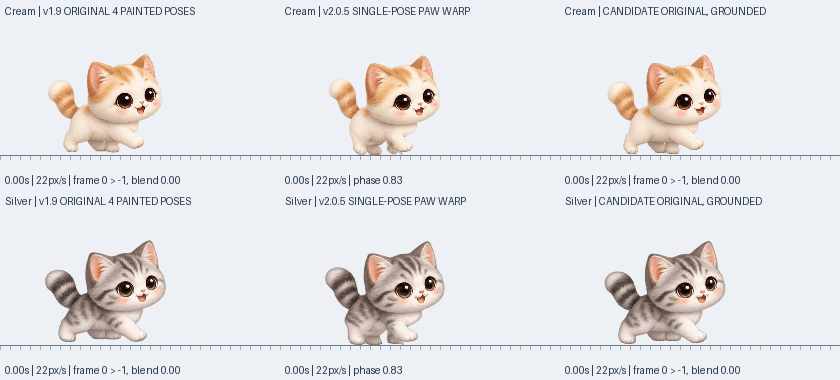

# v2.0.6 — 원본 걷기 복원

크림 치즈냥과 실버 태비냥의 일반 걷기에 초기부터 사용한 원본 네 장을 다시 사용합니다. 한 장의 다리를 분리해 휘고 늘이는 걷기 처리는 이 두 캐릭터의 일반 걷기에서 제외했습니다.

## 확인한 원인과 복원 기준

가장 오래된 공개 버전 v1.3.0의 실행 파일에서 그림을 추출해 현재 에셋과 비교했습니다. 원본 이미지 6개가 바이트 단위로 일치합니다. 이후 v2.0.2에서 일반 걷기를 한 장의 그림과 다리 변형으로 바꿨습니다. v2.0.5 비교 화면에는 다리 마스크 경계가 삼각형으로 갈라지는 구간과 변형된 발 형태가 보입니다.

v1.0의 소스는 남아 있지 않습니다. v1.3.0의 실행 파일과 실제 소스가 남은 v1.8/v1.9를 조사했으며, 이번에는 **v1.8/v1.9의 원본 네 장 순서와 이동 거리 기반 주기**를 복원합니다. 한 주기는 몸 크기 기준 14픽셀이고 각 그림을 60% 동안 유지한 뒤 마지막 40% 동안 다음 그림으로 전환합니다. v1.3의 전체 구간 보간보다 그림 두 장이 겹쳐 보이는 시간을 줄입니다. [출처·실행 파일·소스 조사](validation/original-walk-history.md).

현재 Box2D가 계산한 상대 이동 거리, 성장 크기와 바닥·창 지지 기준은 유지합니다. 과거의 그림 전체 들썩임·회전·세로 크기 변화는 다시 넣지 않았습니다. 움직이지 않을 때 그림 순환도 멈춥니다.

## 비교

왼쪽은 v1.9 원본 동작, 가운데는 v2.0.5, 오른쪽은 이번 복원본입니다. 위는 크림, 아래는 실버이며 모두 22px/s로 이동합니다. 실제 C++ 계산과 원본 이미지에 Pillow 합성을 사용한 비교입니다. Windows GDI+ 실행 검사는 별도입니다.

`python3 tools/render_original_walk_review.py`로 재현할 수 있습니다. 이 도구는 v1.9 아카이브, v2.0.5 고정 커밋, 현재 소스를 각각 컴파일합니다. v1.3 실행 파일에서 확인한 타이밍의 별도 비교도 생성합니다. [비교 파일 출처](previews/v2.0.6-walk-review.json).

## 범위와 검증

- 원본 네 장을 가진 크림·실버의 일반 걷기만 복원합니다. 두 번째 고양이에도 같은 렌더러가 적용됩니다.
- 달리기·살금살금 걷기와 나중에 추가된 동물의 보행은 이번 변경 대상이 아닙니다.
- 저장 형식·경로·생일·성장·체형·성격·기억·친밀도·캐릭터 기록, 무음, 자동 업데이트는 유지합니다. 데이터 마이그레이션은 필요하지 않습니다.
- 원본 프레임 순서·전환·실제 거리·정지·재출발·방향 전환 검사와 기존 저장·물리·커서·창 이동 회귀 검사를 통과했습니다.
- Windows x64 실행 파일 교차 빌드, PE 버전·한국어 대화상자, 로컬 ZIP·업데이트 피드·무음 검증을 통과했습니다.
- Windows 네이티브 검사에는 원본 시트에서 직접 그린 기준 화면과 앱 출력의 픽셀 비교를 추가했습니다. 양방향·세 크기·세 체형·이전 의상 저장 값과 다른 동물의 기존 경로를 검사합니다.

원본 네 장에는 각각 그려진 얼굴·다리 윤곽의 차이가 남아 있습니다. 이번 결과는 초기 그림과 보행 방식의 복원이며 모든 동작의 어색함이 없어졌다는 뜻은 아닙니다.

## 배포 상태

[v2.0.6 정식 릴리스](https://github.com/cho-woo/yeopjari-cat/releases/tag/v2.0.6)를 공개했습니다. [PR 검사](https://github.com/cho-woo/yeopjari-cat/actions/runs/41988642069)와 [배포 검사](https://github.com/cho-woo/yeopjari-cat/actions/runs/41989023903)가 통과했습니다. 배포 소스와 태그는 `07ef22b96f4a42ad1c4a82b8c3f33036958471da`로 일치합니다.

공개 후 `2026-11-05T07:45:47+00:00`에 다섯 파일을 다시 내려받아 크기·SHA-256, ZIP 여섯 항목·CRC, EXE 일치 여부, 버전·노트·공식 업데이트 피드를 검증했습니다. 공식 `latest.txt`는 2.0.6을 가리킵니다. PNG 11개는 태그 소스와 같으며 음원·재생 함수는 없습니다. [공개 파일 검증 기록](validation/v2.0.6-published.json).

| 파일 | SHA-256 |
| --- | --- |
| `YeopjariCat-2.0.6.exe` | `e200ffccc585d6fba90a80323776a2f8d108ae0bc06f710ee8b0e0f3b98cc810` |
| `YeopjariCat-Windows-2.0.6.zip` | `7b7c7beed9a44f517c824d03d442798d1e60da73550e9c2a9577839c49d11840` |
