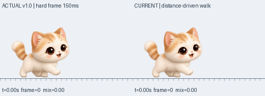

# v2.0.7 — 걷기 그림 겹침 제거

크림 치즈냥·실버 태비냥의 일반 걷기에서 두 원본 그림을 섞던 처리를 제거했습니다. 각 자세를 한 장씩 보여 주므로 전환 중 눈·입·앞발·꼬리가 이중으로 보이지 않습니다.

## 실제 최초 버전으로 확인한 원인

사용자가 제공한 자료의 실제 버전은 v1.0.0입니다. BUILD_INFO.json과 EXE의 버전·크기·SHA-256이 일치합니다. 첨부 소스와 EXE에서 추출한 PNG를 다시 빌드했을 때, COFF와 debug directory의 빌드 시각 두 필드(총 6개 바이트 차이)를 제외한 모든 바이트가 같았습니다. 원래 저장 테스트 8개 그룹·288개 검사도 통과했습니다. [검증 자료](validation/v1.0.0-uploaded.json).

최초 버전은 원본 네 장을 150ms마다 바로 교체했습니다. 현재와 같은 PNG를 사용하지만 이미지 혼합은 없었습니다. v2.0.6에서는 v1.8/v1.9의 짧은 혼합을 남겨 두었기 때문에, 서로 다른 자세에 그려진 눈·입·발이 전환 중 겹쳤습니다.

## 변경 범위

- 원본 0→1→2→3 그림을 순서대로 한 장씩 표시합니다. 그림·다리 형태·캐릭터 크기를 새로 변형하지 않습니다.
- Box2D의 실제 이동과 지지면을 유지합니다. 일반 걷기의 현재 14px 거리 주기도 유지하므로 정지·막힘·메뉴 일시정지 중 제자리걸음하지 않습니다.
- 따라서 최초 버전의 150ms 고정 주기나 물리엔진 도입 전 이동 코드로 돌아가지는 않습니다. 22px/s 성체 기준 약159ms마다 한 장이며, 속도·성장에 따라 발걸음 주기가 맞춰집니다.
- 두 번째 고양이도 같은 렌더러를 사용합니다. 달리기·살금살금 걷기와 다른 동물의 보행은 이번 변경 대상이 아닙니다.
- 생일·성장·체형·성격·기억·친밀도·캐릭터·두 마리 저장 기록, 무음, 자동 업데이트는 유지합니다. 저장 형식·경로 변경이나 마이그레이션은 없습니다.

## 시각 비교

왼쪽은 업로드된 실제 v1.0.0, 오른쪽은 v2.0.7입니다. 같은 22px/s에서 원본 그림을 사용합니다. v1.0의 시간 기반 전환과 현재의 거리 기반 전환 주기 차이는 남지만, 수정본에서도 한 번에 눈·입·발이 한 벌만 보입니다.

이전에는 두 장이 섞였던 120ms·280ms·440ms 구간을 포함해 전체 주기를 확인했습니다. 비교는 업로드 소스의 공식을 재현하고 현재 C++ 평가기를 컴파일해 Pillow로 합성한 것입니다. Windows 실행 화면을 녹화한 영상은 아닙니다.

`python3 tools/render_initial_walk_review.py --reference <업로드 원본 디렉터리> --current-ref HEAD --require-single-frame`으로 재현합니다. 원본 디렉터리에는 main.cpp, BUILD_INFO.json, resources.rc, YeopjariCat.exe와 EXE에서 추출한 assets/cat.png가 필요합니다. 개발 중 소스를 검사할 때는 `--current-ref WORKTREE`를 사용합니다.

## 검증 및 배포

단일 원본 프레임 검사, 정지·재출발·방향 전환·프레임률 검사와 Windows에서 원본 시트를 직접 그린 화면과의 전체 픽셀 비교를 추가했습니다. 이전에 두 장을 섞던 구간도 반드시 원본 한 장과 일치해야 통과합니다.

전체 회귀 검사·Windows x64 빌드·실행·GDI+ 그리기·ZIP·업데이트 피드 검증을 통과하고 [v2.0.7](https://github.com/cho-woo/yeopjari-cat/releases/tag/v2.0.7)을 공개했습니다. [PR 검사](https://github.com/cho-woo/yeopjari-cat/actions/runs/41999066629)와 [배포 검사](https://github.com/cho-woo/yeopjari-cat/actions/runs/41999533221)가 모두 통과했습니다. 소스와 태그는 `73417e28431cacd8173137a48d93c5bbb85f2208`로 일치합니다.

공개 후 `2026-11-05T09:11:26+00:00`에 실제 다섯 파일을 내려받아 크기·SHA-256, ZIP 여섯 항목·CRC, EXE 일치 여부, 버전·노트·공식 업데이트 피드를 확인했습니다. 최신 피드는 2.0.7을 가리키며, PNG 11개는 태그 소스와 같고 음원·재생 함수는 없습니다. [공개 파일 검증 기록](validation/v2.0.7-published.json).

| 파일 | SHA-256 |
| --- | --- |
| `YeopjariCat-2.0.7.exe` | `61be8b04c28f5df3c8d2f2f2de496e89d5955e9bf9fb2e8d22c9783fcb557e2c` |
| `YeopjariCat-Windows-2.0.7.zip` | `90f4989f8c0633e8a4e49ca42510652e9bc5ec972abbbb371bcfc67345eb9518` |
