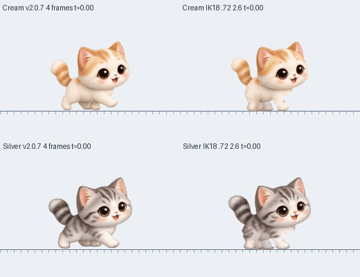

# v2.0.8 — 네 발 접지와 관절 보행

크림·실버의 일반 걷기를 네 발을 따로 움직이는 2D 보행으로 수정합니다. 이전에는 그림 한 장이 유지되는 동안 몸만 전진해, 바닥을 짚은 뒷발까지 약3.5px씩 밀렸습니다. 원본 네 그림의 뒷발 위치 변화도 한 주기에1–1.5px에 불과해 완성된 사족보행 주기가 아니었습니다. [실제 그림 측정](validation/v2.0.7-quadruped-audit.md).

## 수정한 동작

- 같은 쪽 뒷발 다음 앞발이 착지하고, 반대쪽도 같은 순서로 이어집니다. 좌우 같은 다리는 반 주기 차이를 유지합니다.
- 접지한 발은 실제 몸 이동을 상쇄해 바닥 위치를 유지합니다. 발을 들 때만 낮은 곡선으로 앞으로 회수합니다.
- 18px 보폭·72% 지지 구간·2.6px 발 들림을 사용합니다. 짧은 다리를 과하게 뻗어 실제 고양이의 긴 보폭을 흉내 내지 않습니다. [발 순서와 지지 검토](validation/quadruped-contact-order.md).
- 상박·하박은 관절을 중심으로 돌리고 발등·발가락은 한 덩어리로 이동합니다. 좌우 뒷다리는 같은 방향으로 굽히며, 앞다리와 뒷다리는 서로 다른 굽힘을 사용합니다.
- 한 장의 얼굴·귀·등·꼬리를 유지해 걸을 때 머리와 얼굴이 통째로 바뀌지 않습니다. 몸통 털이 다리 뿌리를 가리고, 원래 다리의 조각이 남아 별도의 팔처럼 보이던 경계를 다듬습니다.

## 비교와 범위

왼쪽은 v2.0.7, 오른쪽은 수정본입니다. 위는 크림, 아래는 실버이며 같은22px/s로 이동합니다. 확대 진단 화면은 발의 목표와 관절을 표시합니다.

C++ 실제 관절·발 계산을 실행하고 Pillow로 배치한 개발용 비교이며 Windows 화면 녹화는 아닙니다. `python3 tools/render_joint_walk_review.py`로 재현합니다. [그림 검사 기록](previews/v2.0.8-walk-review.json).

이번 변경은 크림·실버의 일반 걷기와 두 번째 고양이의 같은 동작에 적용됩니다. 달리기·살금살금 걷기 및 다른 동물은 기존 경로를 사용합니다. 모든 동작이 완전히 자연스러워졌다고 주장하는 변경은 아닙니다.

Box2D 이동·창 지지, Windows10/11x64, 생일·성장·체형·성격·기억·친밀도·캐릭터·두 마리 저장 기록, 무음과 자동 업데이트를 유지합니다. 저장 형식·경로 변경이나 마이그레이션은 없습니다.

## 검증과 배포

새 검사는 관절 길이, 실제로 그려지는 발의 접지 좌표, 네 발 순서, 정지·재출발, 원본 머리 픽셀, 그림의 연결·알파와 잘림을 확인합니다. 숫자 검사와 함께 일반 크기·확대·여러 체형의 전체 주기를 검토합니다.

Windows x64 빌드·실행·실제 GDI+ 그리기, ZIP·업데이트 피드 검증을 통과한 뒤 배포하고 공개 파일 검증 결과를 기록합니다.
