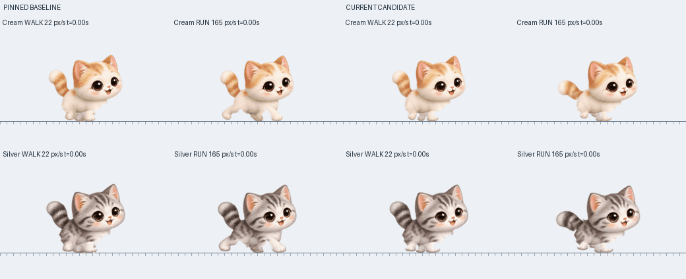

# v2.0.9 — 걷기와 달리기 자세 다듬기

크림·실버의 걷기와 우다다를 서로 다른 자세와 박자로 다듬습니다. v2.0.8은 발 접지를 연결했지만 몸통과 어깨·골반이 고정돼 있었습니다. 우다다는 기존 대각선 속보 렌더러를 사용해, 발을 빨리 움직여도 고양이 특유의 모으기·펴기가 부족했습니다.

## 참고 시트에서 적용한 동작 구성

사용자가 제공한 정지 참고 시트에는 위쪽 두 줄의 걷기 8자세와 아래쪽 두 줄의 달리기 8자세가 있습니다. 걷기는 머리를 안정시키고 꼬리를 세운 상태에서 네 다리가 순서대로 회수됩니다. 달리기는 낮은 자세·앞다리 뻗기·뒷발 모으기·밀어내기와 뒤쪽으로 뻗은 꼬리로 구분됩니다.

이 자세 구성을 기존의 털 있는 크림·실버 캐릭터에 적용합니다. 참고 그림을 프로그램 에셋으로 복사하거나 원본 얼굴을 다른 얼굴로 교체하지 않습니다. 정지 시트로 박자의 기준 자세를 해석하며, 원본 동영상을 프레임별로 추적했다는 의미는 아닙니다. 앞서 제시된 Pinterest 주소는 클라우드에서 403으로 차단되어 영상 자체를 확인하지 못했습니다.

## 구현한 변화

걷기에서는 발의 지지점은 유지하면서 어깨·골반 뿌리와 몸통의 높이·기울기를 작게 움직입니다. 머리는 한 장의 원본을 강체로 움직여 얼굴이 다른 그림으로 바뀌거나 크기가 출렁이지 않게 합니다. 발 들림은 3.1px이며, 18px 보폭과 72% 지지 구간을 사용합니다.

달리기에서는 앞발 두 개가 먼저, 뒷발 두 개가 뒤따르는 갤럽 순서를 사용합니다. 한 주기의 착지 기준은 가까운 앞발 0, 먼 앞발 .10, 가까운 뒷발 .50, 먼 뒷발 .60입니다. 보폭 42px·지지 비율 .32·발 들림 8px를 사용하므로, 기존의 대각선 속보와 박자가 다릅니다. 빠르게 달릴 때 몸통을 약 1–1.8px 낮추고 허리 아래쪽을 작게 모았다 펴며 꼬리를 뒤로 기울입니다. 얼굴 위쪽은 같은 강체 변환을 적용해 눈·입의 상대 크기를 유지합니다.

발 목표는 몸통의 변환 밖에 둡니다. 어깨·골반의 이동을 발에까지 적용해 지지 중인 발이 끌리는 것을 막습니다. 걷기↔달리기는 하나의 접지 제어기를 재설정하지 않고 `Configure()`로 이어갑니다. 이미 땅을 짚은 발의 위치와 진행 중인 회수 궤적은 유지하고, 새 발걸음부터 중립 위치와 박자를 바꿉니다. 실제 이동 속도가 35px/s를 넘으면 달리기로 이어가고 30px/s 아래에서 걷기로 돌아와, 요청한 행동 이름만 바뀐 순간 몸이 갑자기 일어서거나 경계 속도에서 모드가 반복 변경되는 것을 막습니다.

전환 중 보폭과 지지 비율의 보간값이 동시에 커져 짧은 다리의 도달 범위를 넘어가지 않게 새 구성 경로의 뒤쪽 한도는 6.75px, 착지 반보폭 한도는 6.5px로 둡니다. 지지 발을 옮기지 않고 정확한 접점에서 회수를 시작합니다. 이륙·착지의 수평 속도 접선은 짧은 경계 구간에 두어 C1 연속성을 유지하면서도 발이 지나치게 뒤로 꺾이지 않게 합니다. 기존 기본 보행과 적응 속보의 곡선은 유지합니다.

달리기의 짧은 비지지 구간은 스킨의 발 상태와 몸 자세를 표현합니다. 실제 바닥·창 지지와 점프 높이는 계속 Box2D 컨트롤러가 계산하며, 보행 연출이 별도의 점프를 요청하지 않습니다. 실제 발이 하나라도 지지 중이면 공중 자세 가중치는 0으로 유지합니다.

달리기에도 새 관절 렌더러를 사용하고, 다리 위·아래 부분과 발을 나눠 굽힙니다. 목·가슴의 털이 별도 팔처럼 복제되거나 발 위로 얇은 삼각형이 튀어나오지 않게 원본 조각의 범위와 가림 처리를 조절합니다. 공유된 기존 렌더러의 좌우 뒷다리 굽힘 방향도 점검합니다.

## 범위와 호환성

새 몸통·꼬리·갤럽 자세는 크림·실버의 일반 걷기와 우다다에 적용되며 두 번째 고양이도 같은 계산을 사용합니다. 살금살금 걷기와 다른 동물의 기존 렌더 경로는 유지합니다. 공유 코드의 오류 교정은 기존 동작 회귀 검사에 포함합니다.

원본 털 그림과 같은 얼굴을 유지하는 2D 변경입니다. 모든 동작을 완성된 해부학적 고양이 애니메이션으로 바꿨다는 의미는 아닙니다. 짧은 다리와 큰 머리를 가진 기존 캐릭터의 비율 안에서 동작을 조절합니다.

생일·성장·체형·성격·기억·친밀도·캐릭터·두 마리 저장 기록, 무음과 자동 업데이트는 유지합니다. 저장 형식·경로를 바꾸지 않아 마이그레이션이 필요하지 않습니다. Windows 10/11 x64와 Box2D를 유지합니다.

## 검증 결과

새 검사는 발의 세계 좌표, 실제 관절 길이와 발 도달, 걷기→달리기→걷기의 접지 유지, 모드 전환의 회수 속도, 얼굴 강체 거리와 허리 역변환, 꼬리 회전·합성, 캐시 갱신과 잘못된 자세 입력을 확인합니다. 기존 기본 보행·속도 전환·고정 18px 보행의 3,600개 표본은 변경 전과 바이트 단위로 비교했습니다. [변경 전 동작 분석](validation/walk-run-dynamics-audit.md).

실제 원본 PNG를 사용한 네 체형·크림/실버의 전환 검사에서 최대 관절 도달 오차 0px, 실제 지지 발의 세계 좌표 오차 약 `1.14e-13px`를 확인했습니다. 정상 속도 검사에서는 잘못된 알파 합성, 불투명 그림의 출력 경계 잘림과 바닥 아래 침범이 없었습니다. Linux의 실제 C++ 동작 선택기와 관절 렌더러를 사용한 결과이며, 실시간 Windows 창 환경의 기록은 아닙니다. 숫자 검사와 별개로 양방향, 체형별 정지·재출발과 걷기↔달리기 전환을 일반 크기와 확대로 검토합니다. 통합 검증이 진행 중입니다.

로컬 `bash tools/check.sh`에서 단위·저장·Box2D 회귀 검사, Windows x64 교차 빌드, ZIP·업데이트 피드 검증을 통과했습니다. 패키지 EXE에는 음원 리소스와 재생 함수가 없습니다. [PR 검사](https://github.com/cho-woo/yeopjari-cat/actions/runs/42147769414)와 [정식 배포 검사](https://github.com/cho-woo/yeopjari-cat/actions/runs/42148313432)에서도 Windows 실제 실행·GDI+ 그리기와 기존 동작 검사, 두 고양이·4체형의 480프레임 전환 검사를 통과했습니다.

## 동작 비교

왼쪽은 v2.0.8, 오른쪽은 이번 변경입니다. 각 화면의 위는 크림·아래는 실버, 왼쪽 열은 걷기·오른쪽 열은 달리기입니다.

실제 C++ 보행·관절 렌더러를 실행하고 Pillow로 배치한 개발용 비교이며 Windows 화면 녹화는 아닙니다. `python3 tools/render_walk_run_audit.py --source-ref WORKTREE --audit-transitions`로 검사할 수 있습니다. [실제 원본 PNG·4체형 전환 검사](previews/v2.0.9-walk-run-review.json).

## 정식 배포와 공개 파일 확인

[v2.0.9 정식 릴리스](https://github.com/cho-woo/yeopjari-cat/releases/tag/v2.0.9)를 공개했습니다. 태그와 배포 검사를 실행한 소스는 `e3bc5e578d09d1f04b6a2d9c223fbf3f7ea79d33`로 일치합니다.

공개 후 `2026-11-06T02:12:44+00:00`에 파일 다섯 개와 공식 최신 피드를 직접 다시 내려받았습니다. 크기·SHA-256, ZIP 여섯 항목·CRC, ZIP 안의 EXE와 단독 EXE 동일성, 버전·노트·업데이트 URL을 검증했습니다. 공식 최신 피드는 2.0.9를 가리키며, 내장 PNG 11개는 원본·태그 소스와 같고 음원·재생 함수는 없습니다. [공개 검증 기록](validation/v2.0.9-published.json).

| 파일 | SHA-256 |
| --- | --- |
| `YeopjariCat-2.0.9.exe` | `9e4f925d19ede22edccf26ffaea33a576c4ae39a92fe5fbacafc034018fc4f32` |
| `YeopjariCat-Windows-2.0.9.zip` | `29a779df9441e27f2a0dbc337c27d32d37a94c15be52e64768750258afcf0e35` |
